# Hi, I'm XiaoGao 👋

> *Bare-metal firmware in C, retrieval-grounded LLM apps, and handbooks for the layers underneath.*

---

## About Me

---

## What I'm Working With

**Embedded & Hardware**

**Applied AI**

**Backend & Tooling**

---

## 🤝 Let's Connect

I'm open to embedded software and applied AI roles, and always up for a conversation about firmware, retrieval, or tooling.

---

*Build close to the machine. Bring intelligence to the edge.*
