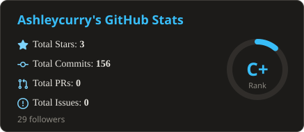
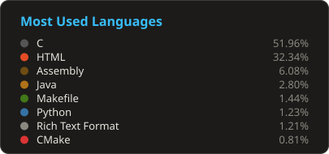

<!-- ═══════════════════════════════════════════════════════════════
     xg@github · Embedded AI / AIoT Engineer
     One Claude Code session: an animated terminal panel on top,
     then two locally generated stat cards side by side.
     All three SVGs live in this repo, so nothing depends on a third party.
     Cards are regenerated daily by .github/workflows/update-profile-cards.yml
     via tools/gen-cards.cjs.
     ═══════════════════════════════════════════════════════════════ -->

 
