<!-- ═══════════════════════════════════════════════════════════════
     xg@github · Embedded AI / AIoT Engineer
     A Claude Code session. The two .svg files are hand-built animated
     terminal panels (SMIL); the two cards are live from github-readme-stats.
     ═══════════════════════════════════════════════════════════════ -->

