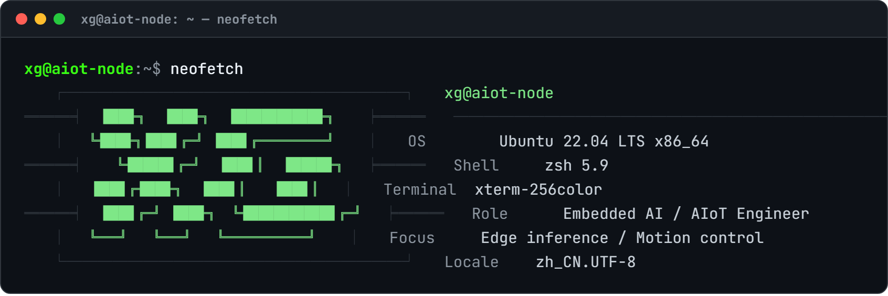
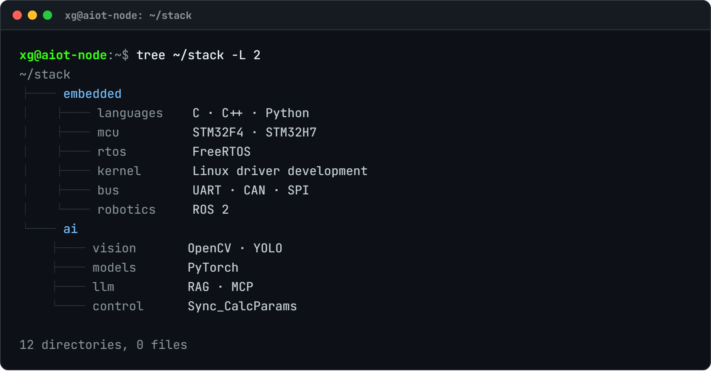
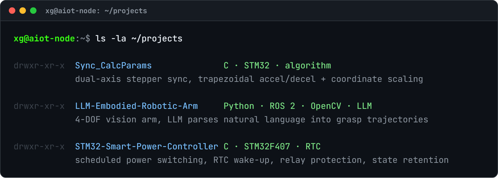
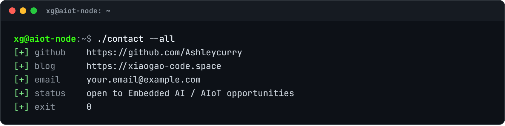

<!-- ═══════════════════════════════════════════════════════════════════
     xg@aiot-node · Embedded AI / AIoT Engineer
     Terminal-styled profile README — every block is a rendered
     #0D1117 terminal window, so the whole page keeps one look
     under both GitHub light and dark themes.
     ═══════════════════════════════════════════════════════════════════ -->

 

 

 

 

