<!-- ═══════════════════════════════════════════════════════════════
     xg@github · Embedded AI / AIoT Engineer
     One Claude Code session: an animated terminal panel on top,
     then the two live github-readme-stats cards side by side.
     ═══════════════════════════════════════════════════════════════ -->

 
